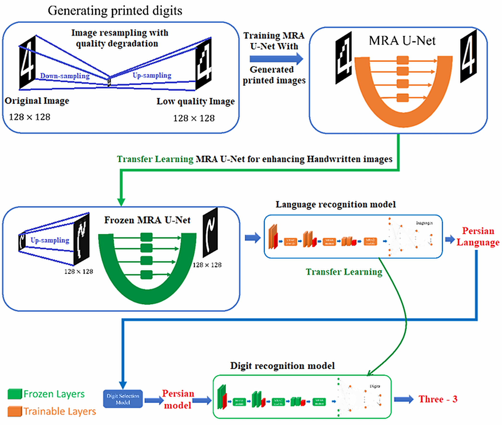

# Multilingual Handwritten Numeral Recognition with Attention-driven Transfer Learning

Code for the paper **Advancing Multilingual Handwritten Numeral Recognition with Attention-driven Transfer Learning**
by Amirreza Fateh, Reza Tahmasbi Birgani, Mansoor Fateh and Vahid Abolghasemi, published in
[IEEE Access, 2024](https://ieeexplore.ieee.org/document/10474004).

<p align="center">
  
</p>

## Method

Handwritten digits from twelve scripts are recognised in three stages (see the figure above):

1. **Restoration.** An MRA U-Net, a U-Net with a multi-resolution attention (MRA) module on each skip
   connection, is trained on printed digits ([DIGITal](digital_dataset/README.md)). Its input is a
   degraded copy of the image (shrunk and enlarged again) and its target is the original.
   Handwritten images are low-resolution and blurry once they are enlarged to 128 x 128, so the network is
   then used, frozen, to enhance them.
2. **Language recognition.** A CNN with MRA modules, working on the restored image, predicts which of the
   twelve scripts a digit is written in.
3. **Digit recognition.** For each language, the convolutional part of the language classifier is reused and
   frozen, and a new dense head is trained to classify the digit.

## Repository layout

```
mranet/             models (MRA module, MRA U-Net, classifiers, baselines), data loading, helpers
scripts/            train_restoration, train_language, train_digit, evaluate
digital_dataset/    generator, fonts and documentation of the printed DIGITal dataset
datasets/           the twelve handwritten datasets (see datasets/README.md)
assets/             figures
```

## Installation

The code was written for Python 3.10 or newer with TensorFlow 2.16.1 and Keras 3.1.1.

```bash
python -m venv .venv
source .venv/bin/activate        # on Windows: .venv\Scripts\activate
pip install -r requirements.txt
```

## Reproducing the pipeline

All commands are run from the repository root.

**1. Generate the printed digits** (11,890 images of 128 x 128 per image size and fill setting):

```bash
python digital_dataset/generate_digital.py --sizes 128 --format npz --out generated
```

**2. Train the restoration U-Net:**

```bash
python -m scripts.train_restoration --printed generated --out checkpoints/mra_unet.keras
```

**3. Train the language classifier:**

```bash
python -m scripts.train_language --unet checkpoints/mra_unet.keras --out checkpoints/language.keras
```

**4. Train and evaluate the digit classifier of a language:**

```bash
python -m scripts.train_digit --language Persian
python -m scripts.evaluate --language Persian --model checkpoints/digit_Persian.keras
```

Available languages: Arabic, ARDIS, BanglaLekha, Chinese, English, Gujarati, Gurmukhi, ISI_Bangla, Kannada,
Persian, Tibetan, Urdu. The training set of each language is augmented with rotations (`mranet/data.py`,
`ROTATIONS`).

**Baselines** (trained on the raw images, for comparison):

```bash
python -m scripts.train_digit --language Persian --baseline lenet5
python -m scripts.train_digit --language Persian --baseline vgg16
```

Settings that the original release did not record, such as the degradation size of stage 1, the loss and the
learning rates, are command-line options (`--help` lists them).

## Data

- [`datasets/`](datasets/README.md): the handwritten datasets, with sizes, formats and sources.
- [`digital_dataset/`](digital_dataset/README.md): the generator of the printed DIGITal dataset.

Each dataset keeps the license of its original authors. Please cite them when you use them.

## Citation

```bibtex
@article{fateh2024advancing,
  title   = {Advancing Multilingual Handwritten Numeral Recognition with Attention-driven Transfer Learning},
  author  = {Fateh, Amirreza and Tahmasbi Birgani, Reza and Fateh, Mansoor and Abolghasemi, Vahid},
  journal = {IEEE Access},
  year    = {2024}
}
```

## License

The code is released under the [MIT License](LICENSE). The DIGITal dataset is for non-commercial research and
educational use; see [digital_dataset/README.md](digital_dataset/README.md) for the terms and the note on fonts.
