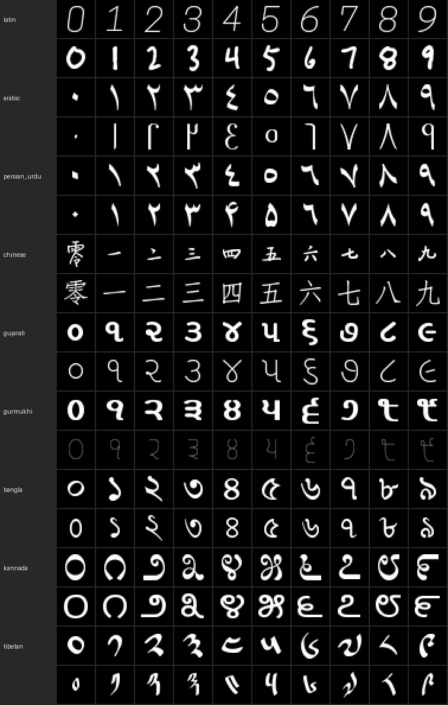
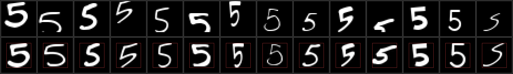

# DIGITal: a synthetic multilingual digit dataset

DIGITal is a set of printed digit images rendered from fonts. It was built for
the paper *Advancing Multilingual Handwritten Numeral Recognition with
Attention-driven Transfer Learning* (see the [main README](../README.md)), where
printed digits are used to pre-train the restoration network before it is
transferred to handwritten data.

This folder contains the generator, the fonts it uses and a preview tool. The
images themselves are produced on demand and are fully deterministic: the same
fonts and settings always give the same pixels.

<p align="center">
  
</p>
<p align="center"><em>Digits 0 to 9 for each script, rendered with two different fonts (32 x 32 images, enlarged 2x).</em></p>

## Scripts and fonts

| Script (`--scripts` value) | Digits | Font folder | Usable fonts |
|---|---|---|---|
| `latin` | 0 1 2 3 4 5 6 7 8 9 | `English`, `ARDIS` | 140 |
| `arabic` | ٠ ١ ٢ ٣ ٤ ٥ ٦ ٧ ٨ ٩ | `Arabic` | 438 |
| `persian_urdu` | ۰ ۱ ۲ ۳ ۴ ۵ ۶ ۷ ۸ ۹ | `Farsi_Urdu` | 395 |
| `chinese` | 零 一 二 三 四 五 六 七 八 九 | `Chinese` | 45 |
| `gujarati` | ૦ ૧ ૨ ૩ ૪ ૫ ૬ ૭ ૮ ૯ | `Gujarati` | 34 |
| `gurmukhi` | ੦ ੧ ੨ ੩ ੪ ੫ ੬ ੭ ੮ ੯ | `Gurmukhi` | 23 |
| `bangla` | ০ ১ ২ ৩ ৪ ৫ ৬ ৭ ৮ ৯ | `ISIBangla_Banglalekha` | 17 |
| `kannada` | ೦ ೧ ೨ ೩ ೪ ೫ ೬ ೭ ೮ ೯ | `Kannada` | 20 |
| `tibetan` | ༠ ༡ ༢ ༣ ༤ ༥ ༦ ༧ ༨ ༩ | `Tibetan` | 28 |

That makes 1,140 fonts and 11,400 images per image size and fill setting. Persian
and Urdu share one set because both use the same Unicode digits.

A font is skipped when it has no glyph for one of the ten digits, and also when it
only draws a placeholder for one of them. Some fonts list a digit in their character
table but draw the "missing character" rectangle, or a solid block, for it. The
generator detects this (the image equals what the font draws for a character it
certainly lacks, it is a hollow box or solid block in the Arabic-script fonts, or two
digits look identical) and skips such fonts: 49 of the 1,189 fonts with complete
digit tables were removed this way. A few unusual but real glyph shapes (very
decorative fonts) can remain.

## The dataset of the paper

The paper describes DIGITal as **100,000 images of 128 x 128 pixels**: ten groups of
10,000 images, 1,000 per digit (Farsi and Urdu share a group, and so do ISI Bangla
and BanglaLekha; ARDIS and English are separate). `generate_paper_dataset.py`
builds exactly this. Groups with fewer than 1,000 fonts are filled up by reusing
the fonts with a random horizontal shift and rotation, the augmentation the paper
uses to balance languages with few fonts. The paper gives neither the shift nor the
angle, so they are options (`--max-shift 10`, `--max-rotation 15`).

```bash
python digital_dataset/generate_paper_dataset.py --out generated
```

`make_release.py` builds the upload package of this version (images, font-based
splits, font license table, dataset card, checksums).

## Generating the images

```bash
pip install pillow numpy fonttools

# 32x32 PNG images for every script
python digital_dataset/generate_digital.py --out generated

# 128x128 images packed into one .npz per script and size (used for training)
python digital_dataset/generate_digital.py --sizes 128 --format npz --out generated

# a few scripts only, several image sizes, two frame sizes
python digital_dataset/generate_digital.py --scripts latin persian_urdu --sizes 32 64 --fill 0.6 0.8
```

| Option | Meaning | Default |
|---|---|---|
| `--scripts` | scripts to generate | all |
| `--sizes` | image side lengths in pixels | `32` |
| `--fill` | frame side as a fraction of the image side; one image per value and font | `0.7` |
| `--normalize` | `font`: one scale for the ten digits of a font; `glyph`: every digit scaled on its own | `font` |
| `--center` | centre the ink bounding box (`bbox`) or its centre of mass (`mass`) | `bbox` |
| `--format` | `png` files or one `digits.npz` | `png` |
| `--fonts` | folder holding one sub-folder of fonts per script | `digital_dataset/fonts` |

### Output layout

```
generated/<script>/<size>x<size>/
    0/ ... 9/            PNG images, one folder per digit (format png)
    digits.npz           x (N, size, size) uint8, y (N,), font_id (N,), fill_percent (N,)  (format npz)
    manifest.csv         font_id, font_file, digit, fill for every image
```

Digits are white (255) on a black (0) background, the same polarity as the
handwritten datasets in this repository. The manifest makes it possible to split
by font (for example, to test on fonts that were never seen in training).

## How a digit is placed: the fixed frame

Fonts disagree about size. Two files rendered "at 12 pt" can produce digits of
quite different height, and they sit at different heights inside the line because
of each font's ascent, descent and side bearings. The first version of the
generator used the font size as the canvas size and trusted the font's own
measurements to centre the glyph, so digits came out clipped, tiny or off-centre
depending on the font.

The generator now ignores those metrics:

1. The digit is drawn large on an empty canvas, and the pixels that were actually
   inked are measured.
2. The result is cropped to that ink bounding box.
3. It is scaled so that the largest digit of the font fills a square frame whose
   side is `--fill` times the image side (70% by default).
4. It is pasted into the middle of the image.

Because the scale is shared by the ten digits of a font, proportions inside a
font are preserved: the Arabic zero stays a small dot and a "1" stays narrow.

<p align="center">
  
</p>
<p align="center"><em>The digit 5 in 14 different fonts. Top row: first version of the generator (size, position and clipping depend on the font). Bottom row: current generator; the red square is the fixed frame.</em></p>

The placement was checked on all 1,140 usable fonts at 32 x 32 with the default fill: the
largest digit of every font is exactly 22 pixels (0.7 x 32, rounded) and its
centre is within half a pixel of the image centre.

## What it is good for

- Pre-training or pre-conditioning models on clean digit shapes before fine-tuning
  on scarce handwritten data, which is how the paper uses it.
- Studying how well a model transfers from printed to handwritten digits, or
  between scripts. The low-resource scripts (Tibetan, Gurmukhi, Gujarati, Kannada)
  profit most because few handwritten samples exist.
- Font-robustness experiments, using `font_id` from the manifest to hold out
  whole fonts.
- Producing paired clean and degraded images, for denoising or super-resolution
  of digits.

## Limitations

- These are printed digits, not handwriting. They are most useful as a source
  domain, and models should still be fine-tuned and evaluated on real handwriting.
- Fonts vary a lot in quality: some are decorative or very thin (a few strokes are
  one pixel wide at 32 x 32), and some scripts have few fonts.
- The Chinese set contains the ten digits only (0 to 9), not the extra
  denominations present in the handwritten Chinese data (15 classes).
- Scale is normalised per font, so apparent size differences between digits of the
  same font (a dot against a full-height digit) are kept on purpose.

## License and citation

The DIGITal dataset is released for non-commercial research and educational use.
If you use it, please cite the paper:

```bibtex
@article{fateh2024advancing,
  title   = {Advancing Multilingual Handwritten Numeral Recognition with Attention-driven Transfer Learning},
  author  = {Fateh, Amirreza and Tahmasbi Birgani, Reza and Fateh, Mansoor and Abolghasemi, Vahid},
  journal = {IEEE Access},
  year    = {2024}
}
```

The generator code is covered by the MIT license of the repository. **The font
files in `fonts/` are third-party works.** Their licenses were not recorded when
they were collected, so they should not be assumed to be redistributable. Check
the license of each font before you redistribute it or the images made from it,
and prefer fonts under open licenses (SIL OFL, Apache 2.0) for anything public.

For questions, please open an issue on the repository.
